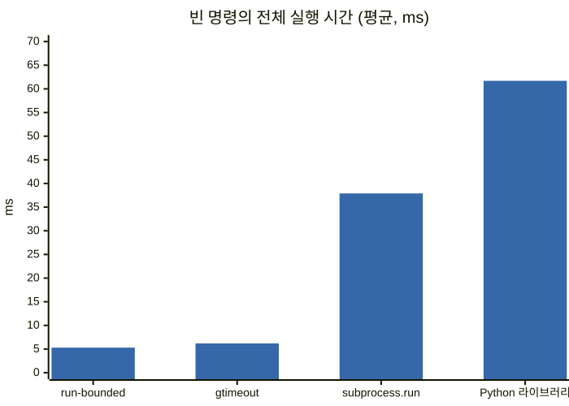

# run-bounded
[English](README.md)

명령의 실행 시간, 출력량, 프로세스 트리를 제한하는 CLI와 Python 라이브러리입니다.

<picture>
  <source media="(prefers-color-scheme: dark)" srcset="https://raw.githubusercontent.com/elfenomenokim/run-bounded/main/docs/demo/run-bounded-dark.gif">
  
</picture>

데모는 정해진 문자열을 `printf`로 출력합니다. 측정 화면은 아닙니다.

## 설치

```sh
pipx install run-bounded
# or
uv tool install run-bounded
```

wheel에는 Rust CLI `run-bounded`와 가져다 쓸 수 있는 Python 패키지 `bounded_run`이 함께 들어 있습니다.

소스에서 설치하려면 Rust 1.75 이상에서 `cargo install --path .`를 실행합니다.

## 빠른 시작

```sh
run-bounded --timeout 5 --idle 2 --max-output 1K -- printf 'bounded output\n'
```

`printf`는 PATH에서 찾습니다. 절대 경로도 사용할 수 있습니다. `/` 또는 `\`가 들어간 상대 경로는 거부합니다.

자식 명령의 stdout과 stderr는 그대로 전달됩니다. 실행 결과 JSON 한 줄은 stderr에 나옵니다.

```text
bounded output
{"class":"ok","duration_ms":6,"exit_code":0,"stdout_truncated":false,"stderr_truncated":false}
```

`--timeout`은 전체 실행 시간(초), `--idle`은 출력이 없을 때의 제한 시간(초)입니다. `--max-output`은 stdout과 stderr 각각에 적용되는 바이트 상한입니다. K, M, G는 1024의 거듭제곱 단위입니다. 시간 제한에 0을 주면 해당 제한을 끕니다. 자식에는 PATH, 로캘, 홈, 임시 디렉터리, Windows 시스템 변수를 전달합니다.

## 비교

`run-bounded`는 stdout과 stderr를 각각 읽고 출력량을 제한합니다. Unix에서는 새 프로세스 그룹을 만들고 제한 시간을 넘기면 TERM을 보낸 뒤 필요한 경우 KILL을 보냅니다. Windows에서는 자식을 Job Object에 넣고 시간 초과 때 작업 전체를 종료합니다. Rust CLI는 단일 실행 파일이고, Python 라이브러리는 네이티브 확장 없이 가져다 씁니다. feno-cli는 기존 `run_process_group` API를 유지합니다.

| 도구 | 전체 시간 제한 | 출력 상한 | 시간 초과 후 손자 프로세스 |
|---|---|---|---|
| run-bounded | 지원 | 스트림별 | macOS, Linux, Windows 검사에서 종료 확인 |
| coreutils `gtimeout` | 지원 | 미지원 | macOS 검사에서 남음 |
| Python `subprocess.run(timeout=...)` | 지원 | 미지원 | macOS 검사에서 남음 |

## 동작 흐름

<picture>
  <source media="(prefers-color-scheme: dark)" srcset="https://raw.githubusercontent.com/elfenomenokim/run-bounded/main/docs/diagrams/flow.ko.dark.svg">
  
</picture>

도표 원본은 [`flow.ko.mmd`](docs/diagrams/flow.ko.mmd)입니다.

## 측정

`/usr/bin/true`를 실행한 `hyperfine` 2.0.0 평균 전체 시간과 표준편차입니다. 측정 호스트는 macOS 27.0 arm64였으며, 준비 실행 3회와 측정 30회를 사용했습니다. Python 명령 항목은 매회 인터프리터를 시작한 시간도 포함합니다.

<picture>
  <source media="(prefers-color-scheme: dark)" srcset="https://raw.githubusercontent.com/elfenomenokim/run-bounded/main/docs/diagrams/bench.ko.dark.svg">
  
</picture>

| 명령 | 평균 ± 표준편차 |
|---|---:|
| run-bounded CLI | 5.3 ± 0.8 ms |
| `gtimeout` | 6.2 ± 0.7 ms |
| Python `subprocess.run` | 37.9 ± 3.5 ms |
| Python 라이브러리 명령 | 61.7 ± 15.4 ms |

이미 실행 중인 Python에서 `bounded_run.run()`을 호출하면 30회 중앙값은 3.5 ms였습니다. [측정 원본](docs/bench/python-in-process-20261117.json)에 호출과 호스트 정보가 있습니다. 손자 프로세스 비교에서는 TERM을 무시하고 30초 대기하는 자식을 실행했습니다. `run-bounded`는 손자 프로세스까지 종료했고, `gtimeout`과 `subprocess.run(timeout=...)`에서는 손자가 남았습니다.

## 플랫폼

CLI는 macOS 27.0 arm64, A1의 Ubuntu 24.04 arm64, Windows 빌드 26340 x64(보고된 OS 버전 10.0.26340.0)에서 빌드와 동작을 확인했습니다. Python 라이브러리는 macOS와 Windows에서 확인했습니다. Windows Rust 빌드는 노트북에 이미 설치된 Rust 1.100 GNU 툴체인으로 진행했습니다. 시간 초과와 유휴 시간 초과는 124, CLI 오류는 125를 반환합니다. 일반 실패는 자식의 종료 코드를 유지합니다.

## 명령 형식

```text
run-bounded [--timeout SEC] [--idle SEC] [--max-output BYTES] -- COMMAND [ARGS...]
```

`COMMAND`에는 절대 경로나 PATH에 있는 명령 이름을 지정합니다. 라이브러리는 `bounded_run.run(command, timeout=60, idle=20, max_output=1048576)`을 제공합니다. 반환값 `RunResult`에는 분류, 실행 시간, 종료 코드, stdout/stderr 바이트와 각각의 잘림 여부가 들어 있습니다. 분류는 `ok`, `failed`, `timeout`, `idle`, `signal`입니다.

## 개발

이 디렉터리에서 `cargo build --locked`를 실행합니다. 이슈와 플랫폼 제보를 환영합니다.

## 라이선스

MIT. `LICENSE`를 참조하세요.
