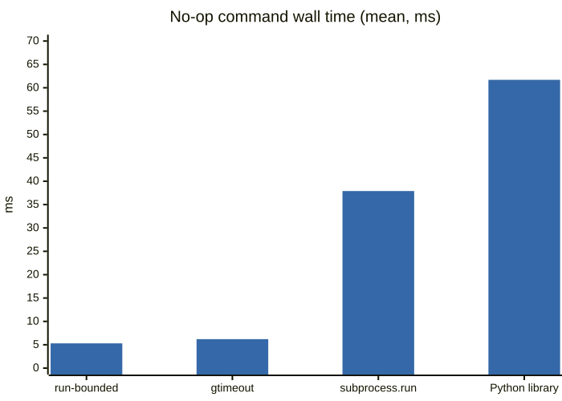

<div align="center">


# run-bounded
[한국어](README.ko.md)

A command-line tool and Python library for running commands with time, output, and process-tree limits.

Rust 1.82+ · Python 3.9+

[](https://pypi.org/project/run-bounded/)
[](https://github.com/elfenomenokim/run-bounded/blob/main/Cargo.toml)
[](https://github.com/elfenomenokim/run-bounded/blob/main/LICENSE)

5.3 ms per run; a Python `subprocess.run` call to the same command takes 37.9 ms. Both from the saved 30-run `hyperfine` file.

[Install](#install) · [Quick start](#quick-start) · [Why](#why)

</div>

<p align="center">
<picture>
  <source media="(prefers-color-scheme: dark)" srcset="https://raw.githubusercontent.com/elfenomenokim/run-bounded/main/docs/demo/run-bounded-dark.gif">
  
</picture>
</p>

The demo uses `printf` with fixed text. It shows command output, not a benchmark.

## Install

```sh
pipx install run-bounded
uv tool install run-bounded
pip install run-bounded
```

Python 3.9+. Wheels for macOS, Linux and Windows install the `run-bounded` binary and the importable
Python package `bounded_run`; no Rust toolchain is needed.

From source (Rust 1.82 or newer):

```sh
git clone https://github.com/elfenomenokim/run-bounded
cd run-bounded
cargo install --locked --path .
```

## Quick start

```sh
run-bounded --timeout 5 --idle 2 --max-output 1K -- printf 'bounded output\n'
```

`printf` resolves through `PATH`. Absolute executable paths also work. Relative paths containing `/` or `\` are rejected.

The child keeps stdout and stderr. The command writes one JSON result line to stderr:

```text
bounded output
{"class":"ok","duration_ms":6,"exit_code":0,"stdout_truncated":false,"stderr_truncated":false}
```

`--timeout` sets wall seconds. `--idle` sets seconds without output. `--max-output` sets the default per-stream byte cap (`--max-stdout` and `--max-stderr` override each stream); K, M, and G use powers of 1024. Zero disables a time limit. `run-bounded --help` lists every option. Child `stdin` is closed by default unless `--stdin inherit` or `--input` is given. The child receives a small environment with PATH, locale, home, temporary-directory, and Windows system variables.

Run in a specific directory with separate stream caps, passed input, and `--kill-on-cap`:

```sh
run-bounded --cwd /tmp --input $'line 1\nline 2\n' --max-stdout 7 --max-stderr 256 --kill-on-cap -- cat
```

```text
line 1
{"class":"output_limit","duration_ms":5,"exit_code":0,"stdout_truncated":true,"stderr_truncated":false}
```

## Why

`run-bounded` drains stdout and stderr independently and limits each stream. On Unix, it starts a new process group and sends TERM followed by KILL when a limit expires. Windows assigns the child to a Job Object and terminates the job on timeout. The Rust CLI is one binary; the Python edition is importable without a native extension. feno-cli keeps its existing `run_process_group` API.

| Tool | Wall timeout | Output cap | Grandchild after timeout |
|---|---|---|---|
| run-bounded | yes | per stream | terminated on macOS, Linux, and Windows checks |
| coreutils `gtimeout` | yes | no | remained alive in the macOS check |
| Python `subprocess.run(timeout=...)` | yes | no | remained alive in the macOS check |

## How it works

<picture>
  <source media="(prefers-color-scheme: dark)" srcset="https://raw.githubusercontent.com/elfenomenokim/run-bounded/main/docs/diagrams/flow.dark.svg">
  
</picture>

The source is [`flow.mmd`](docs/diagrams/flow.mmd); the Korean README has Korean labels.

## Measurements

These are `hyperfine` 2.0.0 wall-time means and standard deviations for `/usr/bin/true`. The host was macOS 27.0 on arm64. Each command ran 3 warmups and 30 measured runs. Python command rows include starting the Python interpreter for each run.

<picture>
  <source media="(prefers-color-scheme: dark)" srcset="https://raw.githubusercontent.com/elfenomenokim/run-bounded/main/docs/diagrams/bench.dark.svg">
  
</picture>

| Command | Mean ± standard deviation |
|---|---:|
| run-bounded CLI | 5.3 ± 0.8 ms |
| `gtimeout` | 6.2 ± 0.7 ms |
| Python `subprocess.run` | 37.9 ± 3.5 ms |
| Python library command | 61.7 ± 15.4 ms |

Re-run from the CCH repository root. The saved measurements are in [`macos-27-arm64-20261117.json`](docs/bench/macos-27-arm64-20261117.json).

```sh
cargo build --locked --release --manifest-path docs/products/feno-cli/bounded-run/Cargo.toml
hyperfine --shell=none --warmup 3 --runs 30 \
  --export-json docs/products/feno-cli/bounded-run/docs/bench/macos-27-arm64-20261117.json \
  --command-name 'run-bounded' './docs/products/feno-cli/bounded-run/target/release/run-bounded --timeout 5 --idle 2 -- /usr/bin/true' \
  --command-name 'gtimeout' '/opt/homebrew/bin/gtimeout 5 /usr/bin/true' \
  --command-name 'Python subprocess.run' '/usr/bin/python3 -c "import subprocess; subprocess.run([\"/usr/bin/true\"], check=True)"' \
  --command-name 'Python library' '/usr/bin/python3 -c "import sys; sys.path.insert(0, \"docs/products/feno-cli/bounded-run/python\"); from bounded_run import run; run([\"/usr/bin/true\"])'
```

Inside an already-started Python interpreter, `bounded_run.run()` had a 3.5 ms median over 30 calls; [the saved samples](docs/bench/python-in-process-20261117.json) include the command and host details. The grandchild comparison used a child that ignored TERM and slept for 30 seconds. `run-bounded` removed it; `gtimeout` and `subprocess.run(timeout=...)` left it alive.

## Reference

```text
run-bounded [OPTIONS] -- COMMAND [ARGS...]
```

`COMMAND` can be an absolute executable path or a bare name found on PATH. `--cwd` sets the working directory. `--stdin` defaults to `null` (closed); pass `inherit` to keep parent stdin, or `--input` to feed UTF-8 text and close stdin. `--max-stdout` and `--max-stderr` override `--max-output` per stream. `--kill-on-cap` terminates the process group or Job Object when either stream exceeds its cap and classifies the run as `output_limit` (exit code 1).

- `--idle-stream stdout` resets the idle clock on stdout activity only. The default, `either`, counts both streams.
- `--env-exact` passes the runner's entire environment to the child. Set the environment when launching the runner to control which variables it receives. The default uses the small allowlist above.
- `--capture-overflow-byte` forwards the first byte over each cap for diagnostics while preserving the cap's kill threshold.
- `--term-grace SEC` sets the Unix TERM grace when a limit fires. The default is 0.2 seconds. Zero sends KILL directly. Windows uses its Job Object.
- `--max-total-output BYTES` sets an additional shared cap for stdout and stderr. Bytes from both streams count, including bytes discarded by a per-stream cap. The readers use the shared budget in the order they read chunks. Any omitted bytes set the corresponding truncation flag. `--kill-on-cap` also applies to the shared cap. The optional per-stream overflow byte must fit inside the shared cap.
- `--no-reap` requests immediate process-tree cleanup at a time limit or a killing output limit, with no TERM grace, then returns without waiting for exit or pending output. If the exit status is still unknown, the result reports `class: "unknown"`, `abandoned_pid`, and `limit` (`timeout`, `idle`, or `output_limit`). The CLI exit code still reflects the triggering limit.
- `--stdout-file PATH` and `--stderr-file PATH` write the child's stream to a file as it arrives instead of forwarding it. `--append` opens the file for appending. Delivery is still capped per stream (`--max-stdout`/`--max-stderr`), so a sink cannot fill a disk unbounded; `--kill-on-cap` keeps its meaning.
- `--merge-stderr` sends both child streams to the stdout sink in arrival order, one ordered log. The merged stream shares one budget: `--max-total-output` when given, otherwise `--max-stdout`. It cannot be combined with `--stderr-file`, `--stderr-keep`, or `--max-stderr`.
- `--stdout-keep tail` and `--stderr-keep tail` keep the newest capped bytes of a stream in a ring buffer and write them when the stream closes. A tail stream is bounded by construction and never trips `--kill-on-cap` for its own stream. The default `head` keeps the first capped bytes as they arrive. A tail keep cannot feed a `--*-file` sink.
- On SIGINT, SIGTERM or SIGHUP (Windows: CTRL_BREAK or console close), the CLI kills the child tree, reports `class: "cancelled"` and exits 130 — distinct from 124 (time limits) and 125 (setup errors).

Python's `bounded_run.run()` exposes the same controls as `idle_stream="stdout"`, `env_exact=True`, `capture_overflow_byte=True` and `term_grace=0.2`. By default, `env` overlays the small allowlist. With `env_exact=True`, the child gets only the `env` mapping, or an empty environment if omitted. `stdin` defaults to closed (`DEVNULL`) and accepts `"inherit"` or a readable file/fd. `input` accepts `bytes` or `str`. `stdout_sink=`/`stderr_sink=` accept a path (opened `wb`, or `ab` with `sink_append=True`), a binary file object, or a callable receiving each chunk in order; returning `False` from the callable stops the run with classification `"stopped"`, and a callback exception stops the run and is re-raised after cleanup. `merge_stderr=True` delivers both streams to the stdout sink in arrival order. `stdout_keep=`/`stderr_keep="tail"` keep the newest capped bytes of a captured stream. `pass_fds=(fd, ...)` forwards extra descriptors on POSIX (ValueError on Windows).

`bounded_run.start()` starts a run and returns a `Run` handle: `pid`, `poll() -> RunResult | None`, `wait(timeout=None) -> RunResult` (raising `TimeoutError` past the wait timeout), and `cancel(reason="cancelled")` (idempotent; TERM then KILL; the context manager cancels on exit). A cancelled run classifies as `"cancelled"` and records `cancel_reason`. Handles from `start()` never install signal handlers. `run()` keeps the 0.1.8 stop-signal behavior: in the main POSIX thread it temporarily turns SIGINT, SIGTERM and SIGHUP into a stop that kills the child tree, restores the previous handlers and re-raises the signal.

`RunResult` includes `classification`, `duration`, `returncode`, captured `stdout` and `stderr` bytes, truncation flags and the cleanup actions taken, if any. With a sink, `stdout`/`stderr` are `b""` and `stdout_bytes`/`stderr_bytes` report how many bytes the child delivered per stream. Use `max_total_output=BYTES` for the shared cap and `no_reap=True` for immediate return. Classifications are `ok`, `failed`, `timeout`, `idle`, `output_limit`, `signal`, `stopped`, `cancelled`, and `unknown`. For `unknown`, `returncode` is `None` and `abandoned_pid` and `limit` describe the incomplete run.

## Platforms

The CLI was built and exercised on macOS 27.0 arm64, Ubuntu 24.04 arm64 on A1, and Windows build 26340 x64 (reported OS version 10.0.26340.0). The Python library was exercised on macOS and Windows. The Windows Rust build used the laptop's existing Rust 1.100 GNU toolchain. Timeout and idle return 124, output-limit kills return 1, CLI errors return 125, and normal child failures retain the child's exit code. A child terminated by a signal returns 128 plus the signal number, and its JSON `exit_code` is null. A consumer that stops reading its output cannot delay a timeout result: once a limit terminates the child, both editions report the timeout without waiting for the blocked output write or for a descendant that left the process group. When the runner itself receives SIGINT, SIGTERM or SIGHUP, it stops the child tree first, writes a `cancelled` verdict and exits 130; on Windows, CTRL_BREAK and console close do the same. A Windows job also ends its children when the runner closes it.

## Contributing

Run `cargo build --locked` from this directory. Issues and platform reports are welcome.
See [CONTRIBUTING.md](CONTRIBUTING.md) for the tests and the review process.

## License

MIT. See [LICENSE](LICENSE).
